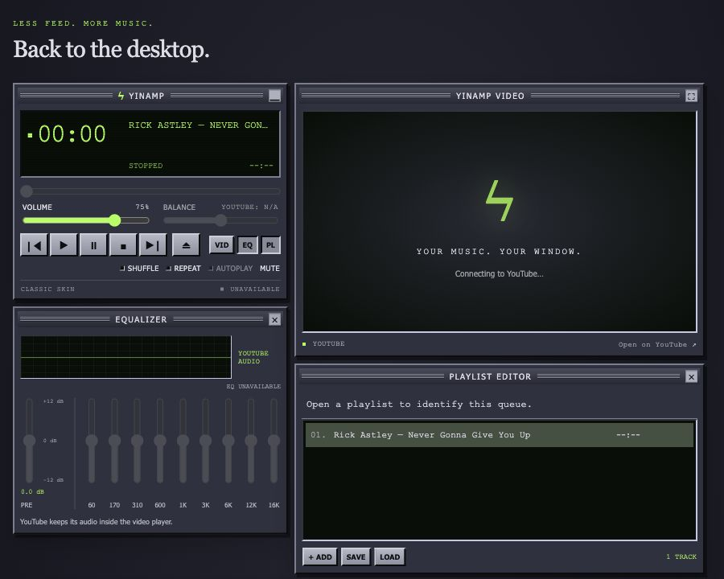

<div align="center">

# ϟ yinamp

**Less feed. More music. Back to the desktop.**

A tiny pet project with one foot in the 2000s and the other in a YouTube queue.

[Download the latest build](https://github.com/KutnerUri/yinamp/releases/tag/latest-build) · [Try the demo](https://kutneruri.github.io/yinamp/) · [Get it running](#press-play) · [Player guide](docs/player-guide.md) · [MIT license](LICENSE)



_Best viewed with your favorite skin and a completely unreasonable attachment to desktop music players._

</div>

## What is this thing?

Remember when a music player looked like a tiny piece of hi-fi equipment? When buttons had edges, displays glowed radioactive green, and rearranging three little windows counted as personal expression?

Yinamp wants some of that back. A familiar, Winamp-inspired interface, rebuilt for modern streaming: draggable windows, a playlist editor, skins, keyboard shortcuts, and YouTube playback. No MP3 collection required. Bring your own questionable taste.

## The actual experiment

This is a pet project exploring how far agentic code building can go with the bare minimum of human intervention. The human brings the idea, taste, nudges, and occasional "that button should probably work." Coding agents do the bulk of the implementation and iteration.

A known interface gives the experiment something concrete to aim at. The nostalgia sets the visual direction; streaming, browser restrictions, persistent state, and desktop integration supply the interesting problems.

This isn't a claim that software now builds itself perfectly. Things break. Assumptions sneak in. A convincing interface can hide an unfinished feature. The point is to find out what works by building something you can actually poke, play with, and inspect. The source, tests, and development notes are here for that reason.

**Small ambition: make a lovely little player. Bigger curiosity: see how little hand-holding it takes.**

## Press play

[Download Yinamp for macOS, Windows, or Linux](https://github.com/KutnerUri/yinamp/releases/tag/latest-build). Runtime included. These unsigned, experimental builds download application updates quietly for the next launch; manage versions under **Yinamp → Updates**.

### Run from source

Requires **Node.js 22.13+** and **pnpm 11.15.1**.

```sh
pnpm install
npm run dev
```

Open **http://127.0.0.1:5173**. Make yourself at home.

For the Electron desktop prototype:

```sh
npm run desktop
```

The runtime may download on first launch. This is a development app, not a signed installer.

## A few honest rough edges

- YouTube audio stays inside its player in a regular browser. The browser equalizer and balance controls are unavailable; the spectrum is a decorative simulation. See the [equalizer notes](docs/equalizer.md) and [visualizer notes](docs/audio-visualizer.md) for desktop behavior.
- Provider pages and internal responses can change. Search, discovery, and desktop integration are experimental.
- Playlists, skins, and layout are saved locally. The desktop YouTube session is separate from your normal browser. See the [account and diagnostics guide](docs/player-guide.md#youtube-account).
- Yinamp is an independent project, unaffiliated with Winamp, YouTube, or Google. Music and third-party branding belong to their respective owners. The MIT license covers this project's code, not streamed media.

## Tinker with it

Plain HTML, CSS, and JavaScript; Preact Signals for reactive state; a small Node server; an Electron desktop shell. No frontend bundler required for local use.

```sh
npm test              # run the test suite
npm run build:pages   # assemble the static demo in dist/
npm run build:desktop # package the desktop app for this computer in release/
```

See the [player guide](docs/player-guide.md) for details and [TODO.md](TODO.md) for the work in progress, warts included.

Bug reports, small fixes, and delightfully unnecessary skins are welcome. Describe what you expected, what happened, and whether you used the browser demo, local browser, or desktop app. Please keep cookies, credentials, and personal diagnostic data out of public issues.

## License

[MIT](LICENSE) · Copyright © 2026 Uri Kutner.

Dependencies keep their own licenses. The Pages build includes the Preact Signals license beside its bundled module.

---

<div align="center">

**✦ UNDER CONSTRUCTION, IN THE GRAND TRADITION OF THE INTERNET ✦**

<div align=center></div>

</div>
